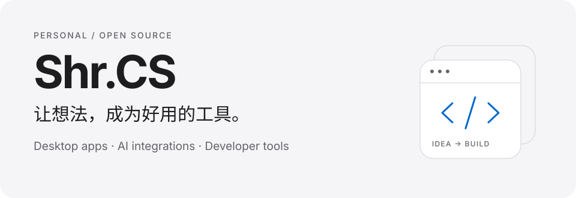

<picture>
  <source media="(max-width: 600px) and (prefers-color-scheme: dark)" srcset="assets/hero-mobile-dark.svg">
  <source media="(max-width: 600px)" srcset="assets/hero-mobile-light.svg">
  <source media="(prefers-color-scheme: dark)" srcset="assets/hero-dark.svg">
  
</picture>

  <a href="#about">关于我</a> &nbsp; / &nbsp;
  <a href="#projects">精选项目</a> &nbsp; / &nbsp;
  <a href="#stack">技术栈</a>

 

## 少一点复杂，多一点好用。

你好，我是 **Shr.CS**。我喜欢把具体的问题，做成可以直接使用的软件。

从离线学习应用、微信 AI 通道，到 Windows 诊断工具，我关注的不只是功能实现，还有清晰的界面、可靠的数据流与可验证的行为。

 

## 精选项目

### 01 &nbsp; WordMaster

**把背单词，变成一件更专注的事。**

离线运行的 Windows 词汇学习应用。涵盖 7 个词库等级，支持中英双向练习、间隔复习、系统语音朗读和明暗主题，学习记录保存在本地。

`Electron` &nbsp; `JavaScript` &nbsp; `HTML / CSS` &nbsp; `Web Audio`

[查看项目 →](https://github.com/Shr-CS/WordMaster-An-Offline-Vocabulary-Trainer-for-Windows)

---

### 02 &nbsp; WeChat × DeepSeek Harness

**一条微信消息，接上你的 AI 工作流。**

通过微信公众号发送指令，驱动 DeepSeek Harness 会话，再将结果异步推回微信。实现回调签名校验、用户白名单、超时取消和分层测试。

`Node.js` &nbsp; `JavaScript` &nbsp; `Cordis` &nbsp; `WeChat API`

[查看项目 →](https://github.com/Shr-CS/dsh-wechat-channel)

---

### 03 &nbsp; VPN Doctor

**让连接问题，有迹可循。**

面向 Windows 的 OpenVPN 诊断工具，用规则引擎分析日志与配置，解释常见连接错误，并提供排查建议。

`C#` &nbsp; `.NET` &nbsp; `WinForms` &nbsp; `Networking`

[查看项目 →](https://github.com/Shr-CS/VPN-Doctor)

 

## 技术栈

| 方向 | 技术与实践 |
| :--- | :--- |
| 应用 | JavaScript · Node.js · Electron · HTML · CSS |
| 桌面 | C# · .NET · Windows Forms |
| 学习 | Python · C++ · Linux · CMake |
| 工程 | Git · 自动化测试 · 异步任务 · 接口集成 |

 

---

  Make it useful. Keep it simple.

